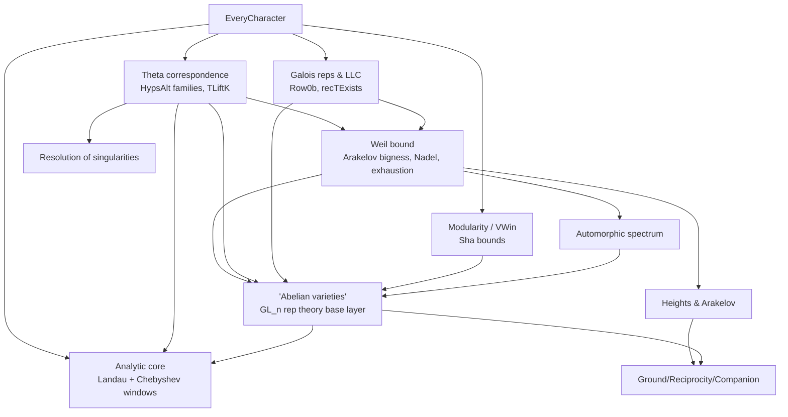

# Blueprint: top layers of the Alpöge RH formalization

A reading guide to the Lean submission mirrored at
[Deicyde/riemann-hypothesis](https://github.com/Deicyde/riemann-hypothesis) (cloned next to this repo as
`../rh-alpoge`). It claims RH, and GRH for every Dirichlet L-function. **Nothing here was compiled.**
Everything comes from reading the source and from the scripted text index in `scripts/`. Names are
real Lean declarations, given as `file:line` under `rh-alpoge/src/`. The plain-math statements are
my reading of the Lean and have not been checked against the author's PDF.

Status of the *proof* itself: Comparator (kernel replay plus axiom check) is still pending. See
`rh-alpoge/verification/NOTES.md`. This document is about **structure**, not correctness.

---

## 0. Scale and what "175k files" means

| Library | Files | Lines |
|---|---:|---:|
| Development | 141,928 | 12.2 M |
| Formalism | 18,254 | 3.2 M |
| GroundTheory | 8,507 | 1.1 M |
| ReciprocityTheory | 3,845 | 0.56 M |
| CompanionTheory | 2,027 | 0.19 M |
| PositivityTheory | 449 | 55 k |

My index found 1,057,373 top-level declarations and 909,823 import edges (`scripts/index.py`, about 50 s).

**Two warnings for readers:**

1. **Directory names do not describe the contents.** `Development/AbelianVarietyTheory`
   (99k files) holds most of the p-adic GL_n representation theory (`GlobalTheory.LocGL.IrrGL`,
   Bernstein–Zelevinsky). `Development/WeilBound` holds Moriwaki bigness, Langlands exhaustion and
   Chow forms. `Development/AutomorphicSpectrum/PublishedTheorems` holds Fargues and Zarhin. The
   namespaces are generic too (`UpperTheory`, `GlobalTheory`, `PositivityTheory`). Classify by
   *declaration*, not by folder.
2. **The import graph says almost nothing about logical dependency.** Every file is in `Main`'s
   import closure. `RiemannHypothesisOfEveryCharacter.lean`, a 230-line elementary argument,
   transitively imports 102,080 modules. So the dependency graphs below are built at the
   **declaration level**: the script finds the names that occur in each declaration's body.

---

## 1. The top: from `Main.lean` to `allChi`

All of §1 is classical complex analysis on top of Mathlib's `riemannZeta`,
`DirichletCharacter.LFunction` and their functional equations. It runs to about 200 lines in total.

### 1.1 The five claimed theorems (`Main.lean`, `Statements.lean`)

| Lean | Proof term | Statement |
|---|---|---|
| `riemannHypothesis` | `rhOfAll` | Mathlib `RiemannHypothesis`: ζ(s)=0, s ∉ {−2,−4,…}, s ≠ 1 ⇒ Re s = ½ |
| `riemannZeta_eq_zero_re` | `rhOfAll` | the same, written out |
| `LFunction_ne_zero_of_half_lt_re` | `allChi` | ∀N≥1, ∀χ mod N, Re s > ½ and (χ ≠ 1 or s ≠ 1) ⇒ L(s,χ) ≠ 0 |
| `LFunction_eq_zero_re` | `claimAll.2.1 = Claim.strip allChi` | 0 < Re s < 1 and L(s,χ) = 0 ⇒ Re s = ½, for every χ (imprimitive included) |
| `LFunction_eq_zero_re_of_isPrimitive` | `critAll = Formalism.VW.critLine allChi` | the same for primitive χ |

`Supplements/Kernels/MainTheorems.lean` defines these four terms. `MainTheoremsCritical`/`All` only
import extra class-number files. They add no logic.

### 1.2 `allChi : UpperTheory.EveryCharacter`

`Development/AutomorphicArithmetic/CharacterBoxes/EveryCharacter.lean:13`

> **(GRH, half-plane form)** For every modulus N ≥ 1, every Dirichlet character χ mod N and every
> s with Re s > ½ (with s ≠ 1 when χ is trivial), L(s, χ) ≠ 0.

`allChi := UpperTheory.FinalTheorems.everyCharacter`. Everything below §1 serves to prove this
one statement.

### 1.3 `rhOfAll = Formalism.VW.rh_of_every allChi`

`Formalism/GammaFactorNonvanishing/CritLine.lean:31`

1. Take N = 1, χ = 1. Mathlib's `LFunction_modOne_eq` gives L(s,1) = ζ(s), so ζ(s) ≠ 0 for
   Re s > ½, s ≠ 1.
2. `Formalism.VW.rh_of_right` (`RhOfRight.lean:5`) handles a zero with Re s < ½ (s ≠ 0). The
   functional equation is ζ(1−s) = 2(2π)^{−s} Γ(s) cos(πs/2) ζ(s) (Mathlib `riemannZeta_one_sub`).
   It sends the zero to 1−s with Re(1−s) > ½. The prefactor is nonzero unless cos(π(1−s)/2) = 0,
   that is unless s = −2k, a trivial zero, which the hypothesis excludes. Contradiction.

### 1.4 `critAll = Formalism.VW.critLine allChi` (primitive χ)

`CritLine.lean:12`

Suppose χ is primitive, 0 < Re s < 1, L(s,χ) = 0 and Re s ≠ ½.
- If Re s > ½, `allChi` applies directly.
- If Re s < ½: the gamma factor is nonzero for Re s > 0 (`gammaFactor_ne_zero`), so the completed
  function Λ(s,χ) = 0. The functional equation `IsPrimitive.completedLFunction_one_sub` relates
  Λ(1−s, χ⁻¹) to Λ(s, χ), so Λ(1−s, χ⁻¹) = 0 and hence L(1−s, χ⁻¹) = 0 with Re(1−s) > ½, which
  contradicts `allChi`.

### 1.5 `Claim.strip` (all χ) and `Claim.zeta`

`Development/AutomorphicArithmetic/CharacterBoxes/ClaimStrip.lean`

- `prim_zero`: L(s,χ) = L(s,χ*) · ∏_{p | N} (1 − χ*(p) p^{−s}), and each Euler factor is nonzero for
  Re s > 0 (`factor_ne_zero`: |χ*(p) p^{−s}| < 1). So zeros in the strip are zeros of the primitive
  χ*.
- `prim_reflect` is the reflection argument of §1.4. `strip` combines the two.
- `zeta` re-derives RH from `HalfPlane` as an independent second route
  (`UpperTheory.riemannHypothesis_of_everyCharacter`, `RiemannHypothesisOfEveryCharacter.lean:215`, is a third).

**Checkpoint.** Everything above `EveryCharacter` is textbook. The whole content is
`FinalTheorems.everyCharacter`.

---

## 2. Unfolding `everyCharacter`

`Development/AutomorphicArithmetic/CharacterBoxes/MainConclusion.lean`

```
everyCharacter := everyCharacter_of_row galoisLocalGlobalStrong_recParameter
everyCharacter_of_row h :=
  every_character_of_literature_of_vWin ⟨h, recTExists, h⟩ (vwin_of_row h)
```

The proof needs three named inputs, then the main assembly.

### 2.1 Input A: `Row0b`, Galois representations for polarized automorphic representations

`Gal.Int.galoisLocalGlobalStrong_recParameter : GalStar.Row0b recT`
(`Foundations/GaloisRepresentations/IntegralStructures/RowSrc.lean:6`). The statement is in
`TypeConditions/WeightsConjBis.lean:54-69`.

> For every CM field E, prime l, isomorphism ι : Q̄_l ≅ ℂ and a ≥ 1, and every cuspidal automorphic
> π of GL_a(𝔸_E) that is regular algebraic and polarized (π^∨ ≅ π^c ⊗ χ∘N_{E/E⁺} for a Hecke
> character χ of E⁺ with the sign condition), there is a continuous semisimple
> r : Gal(Ē/E) → GL_a(Q̄_l) that (i) is compatible with local Langlands `rec` at every place not
> above l, (ii) has Hodge–Tate weights given by the infinity type of π, (iii) satisfies
> HT(τ∘c) = wt − HT(τ), and (iv) has the stated p-adic properties above l (`AboveB`).

This is the known theorem of Harris–Taylor, Shin, Chenevier–Harris and Caraiani. The structure
field is even named `caraianiLocalGlobalDual`. Here it is **proved, not assumed**:
`galoisRepresentations_of_thetaLift (up : TLiftK) := galoisLocalGlobalStrong_of_geometry_lift geoOne_holds up`.

`UpperTheory.TP.TLiftK` (`ThetaParseval/HalfIndexLattices/TLiftK.lean:12`):
> For a CM field E/E⁺, a Hermitian space X of dimension n and skew-Hermitian spaces W of every
> large dimension d ≥ d₀, every automorphic U(X)-representation of weight λ with d + m_W ≤ 2λ (a
> stable-range condition) has a nonzero global theta lift to U(W).

So the Galois-representation input goes through **theta lifting to large unitary groups** and a
geometric realisation, rather than through the Harris–Taylor route of Shimura-variety point counting.

### 2.2 Input B: local Langlands for GL_n

`UpperTheory.Zero.LLC.recTExists : RecTExists`
(`Foundations/LocalLanglands/LocalCentralUnits/RecTExists.lean:20`).

> For every number field E and finite place w there is a map rec from irreducible smooth
> representations of GL_n(E_w) to Weil–Deligne representations. It satisfies the full list of
> properties in `LawsT`: dimensions, characters, cuspidals to irreducibles, the Langlands
> classification on segments, central character, twists, duals, injectivity, depth and type.

It is built from `artEx` (local class field theory), `cuspEx` (cuspidal case) and
`LocLanglands.exists_isLExt` (extension from cuspidals via Zelevinsky segments).

### 2.3 Input C: `VWin`, a bound on Sha lengths for auxiliary fields (**likely crux**)

`UpperTheory.Top.VWin := ∀ ψ : PChar, VWinAt ψ 401`
(`CharacterBoxes/ExistsPageN.lean:12-49`). In plain math:

- `IsChiField ψ e q d E`: E is the subfield of a cyclotomic field ℚ(ζ_N), with
  2^{e+2}, cond(ψ), q, d all dividing N. E is cut out by the conditions a ≡ ±1 mod 2^{e+2},
  ψ(a) = 1, (a/q) = 1 and (a/d) = 1.
- `VVle E t B`: for every choice of local data, every l and every 1 ≤ e < t, the Galois-cohomology
  length `shaLen` of the e-th twist is finite, and
  Σ_{l ∈ S} log l · Σ_{1≤e<t} shaLen_l(e) ≤ B for every finite set S of primes.
- `WinPair ε Y q d`: q, d prime, q ≡ 3 (mod 8), d ≡ 7 (mod 16), log q ≈ Y^{ε/5}, log d ≈ Y^{ε/5} log²Y,
  q | d+1, and every odd prime p ≤ Y^{ε/5} divides d+1.
- `PageN ε x e`: 2^e ≈ x^{2+8ε}.
- **`VWinAt ψ 401`**: for every 0 < ε < 1/52 and every page function e(x) there is J ≥ 1 such that,
  for all large X and all `WinPair`s (q,d) at scale X^{1/J}, some window [Y, Y²] ⊂ [X^{1/J}, X]
  has the following property. For every x in the window and every such field E,
  `VVle E ⌊x^{401}⌋ (exp(x^ε)^{1/2})` holds: the total weighted Sha length over the first
  x^{401} twists is at most e^{x^ε/2}.

Proof: `One.vwin_of_row h := One.Join.automorphic_window_of_inputs (OpenImageCondition.mk h)
BaseChangeIdentities.baseChangeN h` (`AutomorphicVarieties/ModularityArgument/ThresholdArguments/DenseThresholdCases/`).
This is a Selmer-group bound by **automorphy**: Galois representations from 2.1, base change and
CM abelian varieties (`cm_abelian_inputs_from_literature`), much as Bloch–Kato-type bounds follow
from modularity.

### 2.4 The assembly: `every_character_of_literature_of_vWin`

`ThetaCorrespondence/ThetaPairLifts/ThirdPlaceSeries/EveryCharacterOfLiteratureOfVWin.lean:810`

`OpenLiteratureStatements` (line 215) is a `Prop` structure with three fields: Row, RecTExists,
Row. The file then states **195 "literature" theorems** of the form `foo_of_literature (O) : Foo`.
Examples are Hironaka resolution in characteristic 0, Siegel–Weil for unitary groups,
Casselman–Wallach, Harish-Chandra finiteness, Bhatt–Scholze crystalline lattices, Fargues, Zarhin,
Jacquet–Shalika, Bernstein–Zelevinsky, Chebotarev, Moriwaki bigness and arithmetic Hilbert–Samuel.
**Only 4 of the 195 actually use a field of `O`.** The rest ignore `O` and point to in-library
proofs, for example `resolution_char_zero_of_literature O := PositivityTheory.Resplug.ResolutionBlowup.resolutionCharZero`.
`O` itself is supplied by the proved theorems of 2.1–2.2. So the "literature" label marks
**what the author regards as known**, not open hypotheses. This fits Comparator's axiom
whitelist: there are no extra axioms.

Then:

```
every_character_of_theta_integrals_local_matching P F hA hM hX hL hV
  := Top.every_character_of_green_v_win
       (green_of_regular P.greenRegularCharacters)       -- Green's theorem
       hV                                               -- VWin (2.3)
       (nonempty_hyps_definite_side_of_closed_bound …)  -- HypsAlt package
```

- **`GreenBridge.green_of_regular`** (`AbelianVarietyTheory/Proofs/InertiaEigenvalues/SumRangeEqRoots.lean:225`)
  is J. A. Green's 1955 classification. Cuspidal characters of GL_d(𝔽_g) correspond to Frobenius
  orbits of regular characters θ of 𝔽_{g^d}^×. On elliptic elements their values are
  (−1)^{d−1} Σ_i θ(z^{g^i}), and their degree is ∏_{i<d}(g^i − 1). This is known mathematics.
- **`Lit.nonempty_hyps_definite_side_of_closed_bound`** (`…/SiegelEisensteinSecondTermHypotheses.lean:44`)
  builds a `GlobalTheory.Fc.HypsAlt`, a structure of about 40 fields (`ThirdPlaceSeries/Hyps.lean:22`).
  These are a family class 𝒜 of number-field "hosts" with selections, lattice and divisibility
  rows, class-number formulas, twisted-character ties, point counts, and so on. It is assembled
  from the theta correspondence: unramified Howe duality, Siegel–Weil, matching of twisted local
  factors, theta-integral identities and Fourier-coefficient fits. **Likely crux:** this is where
  automorphic forms on definite unitary groups produce the arithmetic families that the analytic
  argument consumes.

### 2.5 The analytic engine: zero-freeness from Chebyshev bounds on windows

```
Top.every_character_of_green_v_win hG hV h := Top.imprimitive (zero_free_all_of_green_v_win hG hV h)
zero_free_all_of_green_v_win := zeroFreeAll_of_topG (la := 3/2)
     (forall_goal_of_shape_of_hyps … (shape_closed_link_n_of_green hG) … h)   -- TopG
     (fun ψ => supplyChi ψ (hV ψ))                                            -- HostExW
```

- `Top.imprimitive` (`CharacterBoxes/Imprimitive.lean:5`) reduces from primitive characters to
  all characters through the Euler factors, as in §1.5.
- `Formalism.HC.ZeroFreeAll`: for every primitive ψ, L(s,ψ) ≠ 0 for Re s > ½.
- `zeroFreeAll_of_topG` → `HC.zeroFreeOn_of_tiedWin_cyc`
  (`Formalism/SharpRestriction/RamificationFrobenius/TotientGaloisClasses/TopWin.lean:90`).
  For each ψ, work with the **cyclic level** Λ = ⟨ψ⟩ (`Level.cyc`) and the weighted Chebyshev sum

  > Gm(y) = G_ζ(y) + Σ_{1≠φ∈⟨ψ⟩} w(φ)·Re g_φ(y),
  > G_ζ(y) = Σ_{n≤y} Λ(n)(y/n − 1) − y log y + (1+γ) y,
  > g_φ(y) = Σ_{n≤y} Λ(n) φ(n)(y/n − 1) + y·L′/L(1,φ)

  (`Formalism/StatementOC.lean`, `…/Analytic.lean:23`). These are Riesz-smoothed prime sums with
  their main terms subtracted. The weights make the combined coefficients nonnegative, Landau-style.
  The proof needs three things:
  1. **Landau step (classical).** `Comparison₂.formB` / `HC.Landau.zero_free_of_Chebyshev_growth`
     (`…/Landau.lean:538`): if Gm(y) ≤ y^θ on a set of "windows" of multiplicative density `la`,
     then no L(s,φ), φ ∈ Λ, vanishes for Re s > θ.
  2. **Chebyshev inequality on windows (likely crux).** `Comparison₂.level_gm_le_on_family_scales := windowInequality_of_artinInputs …`
     (`AutomorphicArithmetic/PrimitiveCosets/`): for a family Fm whose data satisfy `ChainTied`
     (`Formalism/SharpRestriction/GlobalSchurBounds/TieGlobal.lean:97`), Gm(x) ≤ x^{1/2+(e_D+e_L+7)ε}
     for large x in the windows. **This square-root cancellation for prime sums is where RH-strength
     information enters the analysis.**
  3. **Families exist at every scale.** `TopG` (from the HypsAlt package and Green) together with
     `HostExW (3/2)` (from `supplyChi`, i.e. from VWin) give, for every small ε, a family with
     windows of density 3/2 that is tied.

With θ = ½ + O(ε) and ε → 0, this gives zero-freeness for Re s > ½.

---

## 3. Crux vs. library

| Layer | Verdict | Why |
|---|---|---|
| §1 (Main → allChi) | **classical** | Mathlib functional equations; about 200 lines |
| `Top.imprimitive`, `Claim.*` | classical | Euler-factor bookkeeping |
| Landau step (`zero_free_of_Chebyshev_growth`, `FormB`) | classical, formalized | Landau's nonnegative-coefficient theorem |
| **`level_gm_le_on_family_scales` / `windowInequality_of_artinInputs` / `ChainTied`** | **crux (analytic)** | square-root bound for the prime sums, derived from "Artin inputs" of auxiliary fields |
| **`VWin` / `automorphic_window_of_inputs`** | **crux (arithmetic)** | specific constants (401, 1/52, q≡3 mod 8, d≡7 mod 16); Sha bounds by automorphy |
| **`HypsAlt` / `nonempty_hyps_definite_side_of_closed_bound` / `shape_closed_link_n_of_green` → `TopG`** | **crux (construction)** | builds the families from theta lifts on definite unitary groups |
| `Row0b` via `TLiftK` + `geoOne_holds` | known theorem, new route? | Harris–Taylor / Caraiani-type, but proved through theta lifting |
| `recTExists` (LLC for GL_n), Green's theorem | known theorems | library |
| The ~191 `*_of_literature` items that do not touch `O` (Hironaka, Siegel–Weil, Fargues, Bhatt–Scholze, Moriwaki, …) | library | general development; most of the 175k files |

**Rough rule.** Look for declarations whose statements carry concrete constants or ad hoc names
(`CharacterBoxes`, `PrimitiveCosets`, `ThirdPlaceSeries`, `DenseThresholdCases`,
`Formalism.SharpRestriction`). Those are paper-specific. Names ending in `_of_literature` or
`*_holds`/`*_outright`, and folders named `PublishedTheorems`, mark library.

To understand the argument, read in this order:
(1) `ExistsPageN.lean` (VWin definitions), (2) `TopWin.lean` + `Landau.lean`,
(3) `PrimitiveCosets/WindowInequalityOfArtinInputs.lean` and `TieGlobal.lean`,
(4) `ThirdPlaceSeries/Hyps.lean` + `SiegelEisensteinSecondTermHypotheses.lean`,
(5) `DenseThresholdCases/TopMainZj.lean`.

---

## 4. Pillars (declaration-level, depth ≤ 8 from `everyCharacter`)

`scripts/trace.py` runs a BFS over declaration bodies: 27,870 declarations and 81,424 edges at
depth ≤ 8. `scripts/pillars.py` maps module path → pillar.

| Pillar | Decls reached (d≤8) | Files in repo | Lines in repo |
|---|---:|---:|---:|
| Abelian varieties (really: p-adic GL_n rep theory, polarized pairs, cusp reps) | 9,863 | 99,187 | 8.1 M |
| Weil bound (Moriwaki/Hilbert–Samuel, Nadel vanishing, Langlands exhaustion, theta-lift levels) | 4,745 | 7,051 | 0.85 M |
| Heights & Arakelov positivity | 4,296 | 6,859 | 0.70 M |
| Foundations (GroundTheory / Reciprocity / Companion) | 1,807 | 8,136 | 1.24 M |
| Theta correspondence | 1,644 | 3,981 | 0.24 M |
| Automorphic spectrum (incl. many `PublishedTheorems` statements) | 1,343 | 15,147 | 1.20 M |
| Galois reps & local Langlands | 1,195 | 3,633 | 0.36 M |
| Lattices & local-to-global | 892 | 5,501 | 0.96 M |
| Analytic core | 739 | 3,160 | 0.71 M |
| Other Formalism / Development / automorphic arithmetic | ~1,040 | — | — |
| Resolution of singularities | 161 | 499 | 0.14 M |
| Modularity / Sha window (VWin) | 144 | 7,959 | 0.85 M |

The heaviest edges are Weil bound → Abelian varieties (5,751), Theta → Abelian varieties
(4,677), Heights → Foundations (3,597) and Galois reps → Abelian varieties (1,568). The
"Abelian varieties" tree is the shared base layer that everything else draws on.



## 5. Files

| Path | What |
|---|---|
| `graphs/spine.mmd` | curated top-layer graph (§1–2), colored classical / crux / known |
| `graphs/pillars.mmd`, `graphs/pillars.dot` | pillar-level graph with edge counts (decl-level, d≤8) |
| `graphs/decls-depth4.dot` | 441 declarations within 4 steps of `everyCharacter`, colored by pillar |
| `graphs/imports-depth4.dot` | import graph, 4 levels from `MainConclusion` (6,952 modules), grouped by directory |
| `data/summary.json` | the numbers above |
| `data/timeline-keywords.txt` | raw keyword hits for the 20 timeline items (§6) |
| `scripts/` | index → trace → graphs pipeline (see below); `timeline.py` for §6 |

Reproduce (about 2 min, no Lean needed). The commands assume the mirror is cloned next to this repo
as `../rh-alpoge`:
```bash
git clone --depth 1 https://github.com/Deicyde/riemann-hypothesis ../rh-alpoge
export RH_SRC=$PWD/../rh-alpoge/src  W=$PWD/work; mkdir -p $W
python3 -I scripts/index.py $RH_SRC $W                               # decls.tsv, imports.tsv, sizes.tsv
(cd $W && python3 -I ../scripts/trace.py UpperTheory.FinalTheorems.everyCharacter 8 t8.json)
(cd $W && python3 -I ../scripts/trace.py UpperTheory.FinalTheorems.everyCharacter 4 t4.json)
(cd $W && python3 -I ../scripts/imports.py Development.AutomorphicArithmetic.CharacterBoxes.MainConclusion 4 imp4.json)
python3 -I scripts/graphs.py $W graphs
for g in pillars imports-depth4 decls-depth4; do dot -Tsvg graphs/$g.dot -o graphs/$g.svg; done
(cd $W && python3 -I ../scripts/trace.py UpperTheory.FinalTheorems.everyCharacter 12 t12.json)   # ~5 min
(cd $W && python3 -I ../scripts/timeline.py t12.json > ../data/timeline-keywords.txt)
RH_WORK=$W scripts/show.sh UpperTheory.Top.VWin                      # print any declaration
```

## 6. The author's timeline → Lean

The announcement ([remark.pdf](https://alpo.ge/remark.pdf), sha256 `3fc97784…eb8d`, the same file
NOTES.md records) gives the strategy and a 20-item timeline (pp. 3–4). The author warns (footnote 4)
that parts of it paraphrase a Claude-written summary "which might make zero sense", and that the
Lean is authoritative.

**The strategy in one paragraph.** The model is Stepanov's proof of RH for curves over finite
fields. That proof uses an auxiliary function vanishing to high multiplicity at the rational
points. Over ℤ there is no multiplicity. The new idea is that each **theta lift between totally
definite unitary groups stands in for one order of multiplicity**. Chaining
U(X₀) → U(X₁) → … → U(X_m) gives multiplicity m, and for a von Mangoldt sum of length X one takes
**m ≈ √X**. Positivity comes from "Stepanov determinants" of GGP/Bessel periods, aimed at a
Weil-type positivity W(·) ≥ 0 for the smoothed sum Σ_{n≤X} Λ(n)(X/n − 1) − X log X + (1+γ)X.
Done naively, each lift has a "cost" that stops the method at 2/3. Reaching ½ takes averaging over
Hecke characters, an Iwasawa tower (chosen with Behrend sets), and control of H¹(o_E[1/ℓ], ℚ_ℓ/ℤ_ℓ(−e))
classes that twisting cannot kill (a weak form of Vandiver).

**How it fits §2.** The note's smoothed Λ-sum is *literally* `Formalism.G` / `Formalism.Gz`
(`Formalism/Statement.lean`, `StatementOC.lean`). The Landau step of §2.5 turns a bound
Gm ≤ x^{½+O(ε)} into zero-freeness. The theta-chain / determinant / divisibility machinery is what
proves that bound, inside the `ChainTied` / `HypsAlt` package. The note's H¹ classes are the
`shaLen` in `VWin` (§2.3), and its Iwasawa tower is the 2-power cyclotomic level e in
`IsChiField` / `PageN` (ℚ(ζ_{2^{e+2}}), with 2^e ≈ x^{2+8ε}).

### Item-by-item mapping

Method: `scripts/timeline.py` greps declaration and module names for each item's keywords. It
splits the hits into those within 12 steps of `everyCharacter` (157,116 declarations reached at
depth ≤ 12) and the rest. I then read the top hits by hand. Raw output: `data/timeline-keywords.txt`.
"d" is the step distance from `everyCharacter`. **Confidence**: ● the Lean object clearly is the
note's object; ◐ the names and position fit, but I have not read the proof; ○ only weak or
keyword-level evidence.

| # | Note (date) | Where it appears to live in the Lean | Conf. |
|---|---|---|---|
| 1 | Stepanov determinant (10/6) | `Development/WeilBound/ThetaLifts/LeviDeterminants` (430 decls reached); `…/GaloisRepresentations/ThetaParseval/BlockDeterminants` (d=5); `AbelianVarietyTheory/Definitions/GaloisGeometry/DivisionOfDeterminantCharacter` (d=5) | ◐ |
| 2 | Dᵖ ≡ 0 on a CM curve, divisibility of Dᵃθ(0)/Ωᵃ (10/9) | only CM-curve reduction results (`GlobalTheory.Published.cmCurveGoodOutsidePrime`, d=5, `AbelianVarietyTheory/Proofs/DivisorProofs`). No "invariant derivation" names | ○ |
| 3 | qN = Mᵏ + R; path quadric; Parseval iterated k times (10/19+) | `Foundations/GaloisRepresentations/ThetaParseval/` (1,735 decls reached), which is also where `TLiftK` (d=2) lives: `HalfIndexLattices`, `ThetaKernels`, `SchurStep`. Footnote 3's "iterating Parseval k times" matches the folder name | ◐ |
| 4 | W(1_S) ≥ 0 via a determinant (10/6+) | scattered: `GlobalTheory.T.weil_criterion_invariant_measure_homogeneous_space` (d=10), `PerronPsi.w_nonneg` (d=10). No central "W ≥ 0" declaration found by name | ○ |
| 5 | switch to Λ = Σ Λ(n)(X/n−1)₊ − X log X + (1+γ)X; Guinand–Weil (10/20) | **`Formalism.G` / `Formalism.Gz` is exactly this function**; `HC.Level.Gm` combines it over a cyclic group of characters. Explicit formula: `GlobalTheory.ZeroBounds.explicit_formula_and_window_count` (d=7), `ExplicitFormula.truncated_explicit_formula` (d=8) | ● |
| 6 | W(1_{(0,1]} + X^η 1_{(0,1/X]}) ≥ 0 gives zero-free beyond 1 − η (10/8) | the general form is `HC.Level.ChebyshevGrowthImpliesZeroFree` / `Landau.zero_free_of_Chebyshev_growth`: Gm ≤ x^θ ⇒ no zeros past θ (§2.5) | ◐ |
| 7 | determinants of W(·) containing GGP periods; interlacing weights (10/14) | `GlobalTheory.SignedHC.GridData` in `…/Definitions/Foundations/StrictInterlaceIffDescEnum` (d=7); `T.bessel_period_nonvanishing_ascent_of_depth_data` (d=7); `MainNotions.PrimeDegreeVariant.Interlace` in `Formalism/SharpRestriction/Divisibility` (d=7) | ◐ |
| 8 | iterated theta lifts U(X₀) → … → U(X_m), π ↦ π ⊞ μ_j[t]; m ≈ √X (11/15) | `…/Definitions/Divisors/LeastSplitAuxiliaryPrimeThetaChainSpec.lean` (d=7). It holds the chain's dimension bookkeeping, `rankV i j = r + j·t + i·sLen`, over m steps with interlacing grids, and a gap bound containing 48·n²·√m. Also `Corev.ChainParOfGap.chainPar_of_nodeGap` (`ThetaChainStepRealThetaRuleOfNodesFarApart`, d=7) | ◐ |
| 9 | norms of lifts; divisibility via Chowla–Selberg, Weyl, Siegel mass (11/15) | `GlobalTheory.T.unitary_mass_formula` (d=7); `StandardLattice.SiegelMassRatioCM` in `Formalism/SharpRestriction/GlobalSchurBounds` (d=7); `Formalism/PeriodIntegrals/UnitaryGroupMassFormula` (~700 decls reached). Chowla–Selberg: 323 decls in `GroundTheory/HeightsAndTheta`, none reached at d ≤ 12 | ● mass / ○ Chowla–Selberg |
| 10 | lower bound on divisibility of the m-fold lift (11/15) | `UpperTheory.Gal.Int.Div.*` (`IntegralStructures/ZetaCharacterDivisibility`, d=5); `Formalism/SharpRestriction/Divisibility`; `Formalism/LocalToGlobal/Divisibility` (its `DivisionCompatibilityDataThreeSided` appears in `DefiniteSideCondition`, §2.4) | ◐ |
| 11 | Iwasawa tower, by analogy with 𝔽_{qⁿ}/𝔽_q (10/6) | **the 2-power cyclotomic level e in `UpperTheory.Top.IsChiField` / `PageN`** (§2.3). The keyword "Iwasawa" mostly hits `AbelianVarietyTheory/Proofs/IwasawaDecomposition` (G = KAN), which is unrelated | ● |
| 12 | seesaw: the iterated lift's period is a Bessel period; Rallis (11/15) | `UpperTheory.TP.rallis_k` (`ThetaParseval/ThetaKernels/TPGRallis`, d=5); `Lit.Rallis.RallisIPProof.rallis_of_dm` (d=5); `ThetaCorrespondence/RallisInnerProduct`; `Core.Rk.Seesaw.seesaw_fubini` (d=6); `T.exists_seesaw_pair_of_theta_data` | ● |
| 13 | Bost slope inequality (10/6) | `TraceIntegrality.slope_inequality_family_four` / `lower_slope_inequality_family` (`Formalism/LocalToGlobal/GlobalTheory/GL4`, d=9); `Formalism/HarderNarasimhan/…/SlopeIneqMean`. The Arakelov layer (Moriwaki bigness, arithmetic Hilbert–Samuel, §2.4) is related | ◐ |
| 14 | "cost" of each lift; stops at 2/3; need for "division" (11/15) | `ChainTied`'s `CostWindows` / `ErrWindows` / `RestSize` (§2.5); `Gal.Int.Div.divAll_holds` (`DivisionOneGeometricRepresentation`, d=6). The exponent 2/3 itself was not located | ◐ |
| 15 | integral structure across Hecke characters, a "gcd" (11/15) | `Foundations/GaloisRepresentations/IntegralStructures/` (738 decls reached). Notably **`Row0b` itself is proved there** (`galoisLocalGlobalStrong_recParameter`, d=1) | ◐ |
| 16 | relative trace formula; projected Poincaré series; approximate orthogonality (10/14) | `AbelianVarietyTheory/Proofs/TwistedOperators/PoincareSeries*`: `poincareSeries_pairing_ne_zero_of_large_level` (d=9), `IdDom.identity_dominates` (d=10) | ◐ |
| 17 | classes in H¹(o_E[1/ℓ], ℚ_ℓ/ℤ_ℓ(−e)) not killed by twisting; weak Vandiver (11/15) | **`Formalism.GaloisCohomology.shaLen`** (d=7), the quantity bounded in `VWin`; `AutomorphicVarieties/GaloisLibrary/GaloisCohomologyLength`, `SelmerTransport.ShaLenEq`. No declaration is named "Vandiver", "Lichtenbaum" or "K-group" | ● object / ○ Vandiver step |
| 18 | covolumes, theta-series index, congruences between lifts and forms (11/15) | `GlobalTheory.CovTop.CovolumeBoundOfX` (d=4); `SelfIntersectionVolumeEstimates.topCovolSlim2_use_alt_alt` (d=3); `AbelianVarietyTheory/Proofs/CovolumeBounds`; `GroundTheory/HeightsAndTheta/Heights/FiniteCovolume` | ● |
| 19 | the precise Iwasawa tower, using Behrend (10/19) | `Formalism/BehrendSets/` (89 decls). `OrdGrp s = (ℤ/2^{s+2})^× / ±1` is the Galois group of the tower layer in item 11. It is imported only by `Formalism/GL3MeanSquares/HookFormulaTorsion/DifferenceStableUnderAction`. **No Behrend declaration is reached at d ≤ 12.** Either it sits deeper, or my resolver misses it (the file uses `open`), or it is unused. Unresolved | ◐ |
| 20 | GRH (11/16) | `allChi` / `UpperTheory.FinalTheorems.everyCharacter` (§1.2) | ● |

**What this adds to §3 (crux vs. library).**
- **The theta chain (items 7, 8, 10, 12, 14)** is the conceptual heart. Its Lean lives mostly in
  the misleadingly named `AbelianVarietyTheory/{Definitions,Proofs}` subtrees `Divisors`,
  `Foundations`, `TwistedOperators` and `DecoratedLatticeProofs`, and in `ThetaParseval`. So
  "AbelianVarietyTheory" is not only shared library: some paper-specific steps are inside it. The
  next tracing target is `LeastSplitAuxiliaryPrimeThetaChainSpec` and what consumes it.
- **The note's chronology runs** determinant (10/6) → Λ-sum (10/20) → theta chains, cost, H¹,
  covolumes (all 11/15) → GRH (11/16). So the √X-chain machinery was assembled in the final days.
  Those are the items marked ◐ above, and the places where reading the proofs will pay off most.
- **Items I could not pin down:** 2 (the derivation on CM curves), 4 (a central W ≥ 0 statement)
  and the Vandiver/K-group step of 17. The note's own vocabulary does not appear in the code.
  Finding them needs proof-level tracing, not name search.

## 7. Limits of this analysis

- **The name resolution is heuristic.** It catches fully qualified names, names under the current
  namespace and names under `open` namespaces. It misses instances, `simp` and tactic-found lemmas,
  dot-notation such as `h.foo`, and auto-generated names. The declaration counts are **lower
  bounds**, and the pillar shares are indicative only.
- Indented or `private` declarations inside sections are partly missed: 1,057,373 indexed vs.
  1,060,822 counted by NOTES.md.
- The plain-math readings of `VWin`, `TLiftK` and `HypsAlt` are paraphrases of long Lean
  statements. The announcement (§6) is a 4-page note, not a paper, so it cannot check them in
  detail. It does confirm the overall shape: theta chains, the Λ-sum, Iwasawa tower and H¹ classes.
- "Crux" is a judgment from naming, constants and position in the graph, not from understanding
  the proofs.
